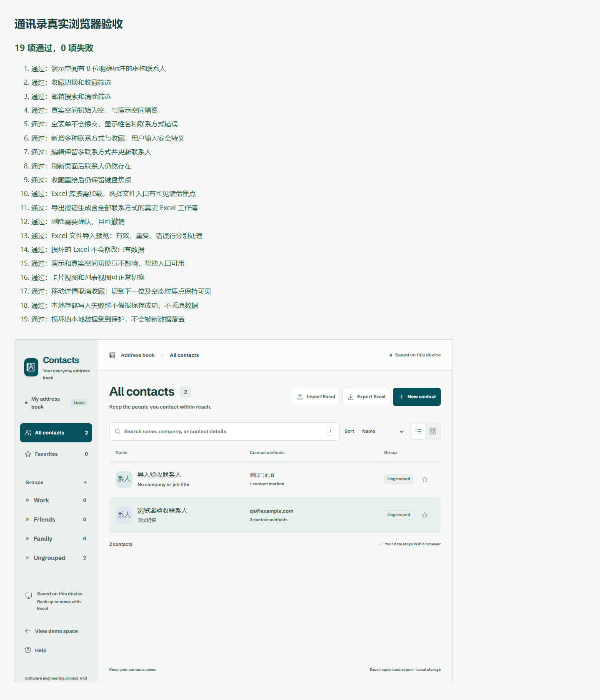

# 通讯录功能验收报告

检查日期：2026-11-16。对象：英语版浏览器通讯录。

## 方法与结果

| 检查 | 结果 | 方法 |
|---|---|---|
| 核心数据测试 | 13 项通过 | `node --test TEST/core.test.cjs` |
| 浏览器验收 | 19 项通过 | 在独立浏览器运行 `TEST/browser-tests.html` |
| JavaScript 语法 | 通过 | `node --check core.js`、`node --check app.js` |
| Excel 数据往返 | 通过 | 生成真实 `.xlsx` 字节，重新读取并比较联系人签名 |
| 响应式布局 | 通过 | 检查 1440、1024、768、390、320px 宽度，未发现横向溢出 |
| 英语界面与旧数据兼容 | 通过 | 检查编辑、导入预览、英语表头和中文旧存储恢复 |

核心测试涵盖字段校验、多个同类型联系方式、自定义类型、特殊字符、空模板、重复记录、损坏元数据、搜索组合、公式形文本以及中英文表头兼容。

浏览器验收涵盖演示数据标识、个人空间隔离、新增编辑、收藏与筛选、搜索空态、多条联系方式、输入转义、刷新恢复、Excel 按需加载、导出、导入预览、删除撤销、视图切换、帮助、焦点回退和存储异常保护。

浏览器验收通过页面控件和 DOM 事件驱动，不覆盖系统剪贴板权限、下载对话框、所有外部表格软件和所有触摸设备。外部表格软件打开导出文件及完整演示视频需单独检查。

## 界面与键盘操作

已检查桌面列表、手机列表与详情、联系人编辑和导入预览。相关运行截图位于 `images/`。

收藏重绘引起的焦点丢失、文件选择入口缺少可见焦点的问题已修复。取消当前或最后一位收藏后，焦点回到可见操作。编辑和导入使用原生 `dialog`；手机详情打开时限制背景操作。

## 本机性能记录

| 指标 | 桌面 1440px | 手机 390px |
|---|---:|---:|
| 首屏传输量（本地 HTTP 压缩值） | 121.1 KiB | 120.7 KiB |
| 初始解析 JavaScript | 34.7 KiB | 34.7 KiB |
| FCP / LCP | 344 / 344 ms | 248 / 248 ms |
| 布局偏移 | 0.000 | 0.000 |
| 失败的资源请求 | 0 | 0 |

每种尺寸运行一次，数据用于本机诊断，不能代表所有网络和设备的表现。Excel 库约 930 KiB，在首次使用 Excel 功能时从本地资源加载。字体、图标与脚本均由项目提供。

## 使用限制

- 数据保存在当前浏览器，不支持账号登录、跨设备同步或多人实时编辑。
- 清除站点数据会清除通讯录，需要定期导出备份。
- Excel 读取第一张工作表，限制 5 MB、10000 行联系人，不支持加密工作簿。
- 手动修改可见联系方式列前，需要清空对应行隐藏的 `Contact methods JSON` 单元格。
- 邮箱只检查基本格式，不验证地址是否真实可投递。

本报告记录功能、数据、布局和性能检查范围，不表示所有设备、软件和使用场景均已验收。课程提交材料按[提交清单](提交清单.md)另行核对。
